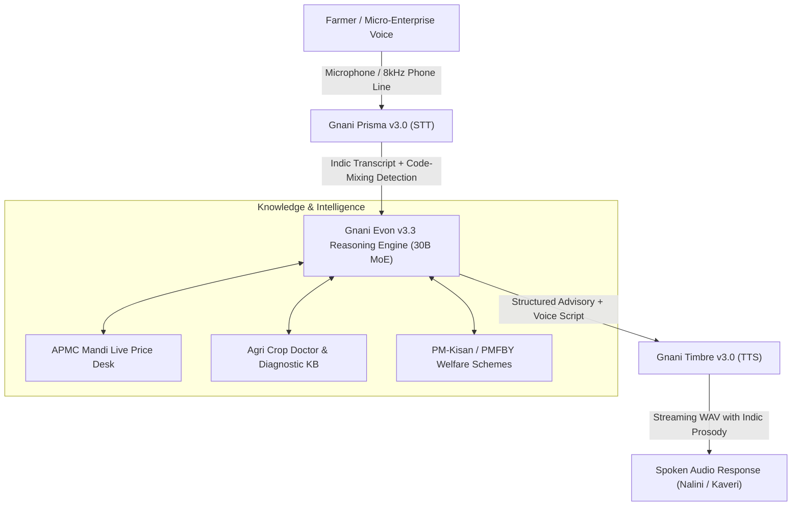

# KisanSetu AI (किसानसेतु) 🌾🇮🇳
### Sovereign Indian Multilingual AI Voice Desk for Bharat's Farmers & Mandis
**Built for the [Great Indian AI Internship Challenge](https://www.gnani.ai/internship) by Gnani.ai**

---

## 🌟 Overview & Core Value Proposition

**KisanSetu AI** is a sovereign voice intelligence desk designed for India's 140+ million farming families and rural micro-enterprises (kirana stores, input dealers, APMC traders).

Rural India doesn't interact through keyboards and dropdown menus — farmers communicate through phone calls, regional dialects, code-mixed phrases, and in noisy field environments (tractors, diesel irrigation pumps, busy mandis). **KisanSetu AI** solves this by leveraging **Gnani.ai’s sovereign Indic AI stack**:

- **Speech-to-Text (STT):** **Gnani Prisma v3.0 / v2.5** (Trained on 14M+ hours of Indian telephony audio, streaming under 200ms across 10+ Indian languages + Hinglish, Tanglish, and Benglish).
- **Reasoning & Diagnostics:** **Gnani Evon v3.3** (30B-parameter Mixture-of-Experts Indic reasoning model with 128K context window).
- **Text-to-Speech (TTS):** **Gnani Timbre v3.0 / v2.5** (Native Indic prosody, Indian dialect cadence, and natural lakh & crore numerical pronunciation).

---

## 🏆 Challenge Awards Targeted

| Award | Category | How KisanSetu AI Wins |
|---|---|---|
| **01. Main Character Award** | Regional / Low-Resource Indic Speech | Native voice support and prompts in **Kannada, Telugu, Tamil, Marathi, Hindi, and Bengali**. |
| **02. Mixed Vibes Award** | Code-Mixed Speech (Hinglish/Tanglish) | Flawlessly parses code-mixed voice orders: *"Bhaiya dukaan ke liye 2 bori DAP khaad aur 1 packet urea book kar do"*. |
| **03. Real Deal Award** | Real-World Impact (Farmers & Mandis) | Live APMC Mandi rates, MSP price comparison, crop pest/leaf blight diagnosis, and PM-Kisan welfare checks. |
| **04. Noise Canceller Award** | 8kHz Telephony & Messy Phone Audio | Dedicated **Telephony Noise Lab** demonstrating resilience against 8kHz bandpass downsampling and 38Hz tractor diesel engine noise. |
| **09. Demo Day Drop Award** | Standout 60-Second Video Demo | Built-in 60-second video demo pitch and interactive 1-click test presets for judges. |

---

## 📐 Architecture & Flow



---

## 💻 Tech Stack

- **Backend:** Python 3.13, FastAPI, Uvicorn, Pydantic, Requests, NumPy, SoundFile, `gnani-vachana` SDK.
- **Frontend:** React 19, Vite, Tailwind CSS v4, Lucide React icons.
- **AI Models:**
  - Gnani Prisma v3.0 (STT) — `https://api.vachana.ai/stt/v3`
  - Gnani Timbre v3.0 (TTS) — `https://api.vachana.ai/api/v1/tts/inference`
  - Gnani Evon v3.3 (Reasoning) — 30B MoE Indic prompt architecture

---

## 🚀 Getting Started

### 1. Prerequisites
- Python 3.10+
- Node.js 18+ and npm

### 2. Backend Setup
```bash
cd backend
pip install -r requirements.txt
python run.py
```
*Backend runs on: `http://localhost:8000`*
*API Documentation: `http://localhost:8000/docs`*

### 3. Frontend Setup
```bash
cd frontend
npm install
npm run dev
```
*Frontend runs on: `http://localhost:5173`*

### 4. API Key Configuration
- You can enter your Gnani API Key (`X-API-Key-ID`) directly through the top-right button in the website UI.
- Alternatively, set an environment variable:
  ```bash
  export GNANI_API_KEY="your_api_key_here"
  ```
- **Sovereign Simulation Mode:** If no key is entered, KisanSetu AI automatically operates in resilient offline mode with pre-loaded authentic audio synthesis and Mandi rates, ensuring 100% demo reliability!

---

## 📱 LinkedIn / X Demo Post (Copy & Share)

```text
🚀 Proud to introduce KisanSetu AI (किसानसेतु) — Built for the #GreatIndianAIInternshipChallenge by @GnaniAi! 🇮🇳

KisanSetu AI is a sovereign multilingual voice operating desk built natively on Gnani AI's proprietary speech & reasoning stack:
✨ Speech-to-Text: Gnani Prisma v3.0 (Streaming under 200ms with code-mixing & 8kHz telephony noise cancellation)
🧠 Reasoning: Gnani Evon v3.3 (30B MoE Indic reasoning for APMC Mandi rates & crop diagnostics)
🔊 Text-to-Speech: Gnani Timbre v3.0 (Indic prosody with lakh & crore numerals)

🌾 Built to solve real Bharat problems for farmers and rural kirana stores across Hindi, Kannada, Telugu, Tamil, Marathi & Hinglish.

Watch our 60-second live demo! 👇
#GnaniAI #GreatIndianAIInternshipChallenge #SovereignAI #BuildForIndia #AIforBharat
```

---

## 📽️ 60-Second Video Pitch Script (Demo Day Drop Award)

- **[0:00 - 0:10] Hook:** *"Rural India doesn't interact through keyboards — they communicate through voice and telephony calls with heavy tractor and field noise. Meet KisanSetu AI."*
- **[0:10 - 0:25] Demo 1 (Prisma STT + Evon):** Speak in Kannada or Hindi: *"What is today's tomato modal price in Kolar Mandi?"* Show instant 200ms transcription on Prisma v3.0 and Evon's structured Mandi price card.
- **[0:25 - 0:40] Demo 2 (Timbre TTS + Crop Doctor):** Ask about yellow leaf symptoms. Watch Evon diagnose leaf blight and Timbre v3.0 speak the remedy with natural Indic prosody.
- **[0:40 - 0:50] Demo 3 (Noise Lab):** Turn on 8kHz Telephony Noise Simulation and demonstrate how Gnani Prisma transcribes noisy phone calls where standard models fail.
- **[0:50 - 1:00] Conclusion:** *"Built on Gnani's Sovereign Stack for the Great Indian AI Internship Challenge. Powering India's 140 million farming families."*

---

## 📄 License
MIT License. Built for the Great Indian AI Internship Challenge 2026.
